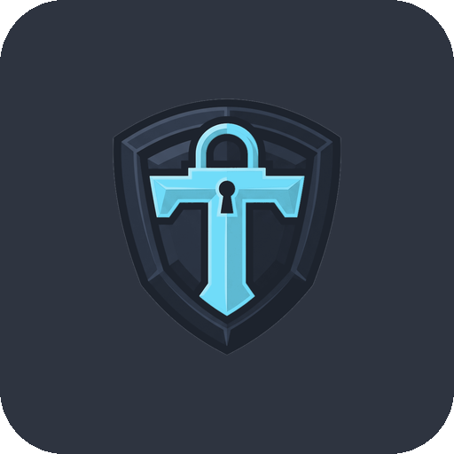

  

# Trove

**A clean-room, reproducible Android file manager** — local, network, cloud and archive storage behind one unified filesystem abstraction, with built-in media engines, an encrypted vault, embedded servers, storage cleaning, and a privilege layer for Shizuku/root. Apache-2.0 licensed.

> Clean-room: Trove reimplements functionality users know from MiXplorer (file management) and from established maintenance tools such as SD Maid SE (storage cleaning), but contains **no** decompiled or proprietary code. See [UI parity & clean-room policy](ui-parity.md).

## Features

- **Browsing** — list/grid views, per-pane tabs, dual-pane mode with cross-pane copy/move, breadcrumbs with disk-usage chip, recursive search, select-by-pattern, bookmarks, Home dashboard with MediaStore category stats.
- **Backends** — local storage (`File`), SAF/Storage Access Framework documents, FTP, SFTP, SMB, WebDAV, cloud (Google Drive, Dropbox, OneDrive, MediaFire, TeraBox), inside-archive browsing (ZIP/7Z/TAR/GZ/BZ2/XZ/RAR), encrypted vault.
- **Engines** — image viewer, PDF viewer, Media3 media player with metadata tagging/editing (audio, images, video, ebooks).
- **Tools** — archive creation & extraction, checksums (MD5/SHA-256), text editor, Termux integration, recycle bin with restore, embedded FTP/WebDAV/SFTP servers.
- **Cleaning** — App Cleaner (public + private caches), Corpse Finder (leftovers of uninstalled apps), Deduplicator (content-hash + name matching), System Cleaner (toggleable filters); works without root on public storage, with root (`su`) on private app data, or via an accessibility automation that drives the system "Clear cache" screen.
- **Privilege** — Shizuku/user-service IPC for privileged browsing and operations; direct `su` (Magisk-compatible) shell for the Cleaner's private-data scans.
- **Security** — AES-256-GCM chunked vault with Argon2id key derivation and biometric binding; caller-UID-validated privilege service; validated-names-only root shell; no telemetry.

## Documentation

| Page | Contents |
| --- | --- |
| [Architecture](architecture.md) | Module map, the `FileItem` abstraction, privilege & engine design |
| [Building](building.md) | Prerequisites, version stamping, reproducible builds |
| [Releases](releases.md) | Tag pipeline, unsigned CI builds, local signing flow |
| [Security model](security.md) | Permissions, sandboxing, vault crypto, servers, audits |
| [UI parity & clean-room policy](ui-parity.md) | What is replicated, what is never copied |
| [CI workflows](workflows.md) | The GitHub Actions pipelines and their contracts |
| [Roadmap](roadmap.md) | Honest list of what is not done yet |

## Status

- All 163 unit tests green across modules.
- Release APKs are built **unsigned** by CI on `vYYYY.MM.DD` tags and signed only on the maintainer's machine — [release flow](releases.md).
- CI badge: ``

## License

Apache-2.0 — see [LICENSE](https://github.com/fam007e/trove/blob/main/LICENSE) and [NOTICE.md](https://github.com/fam007e/trove/blob/main/NOTICE.md) for third-party components.
